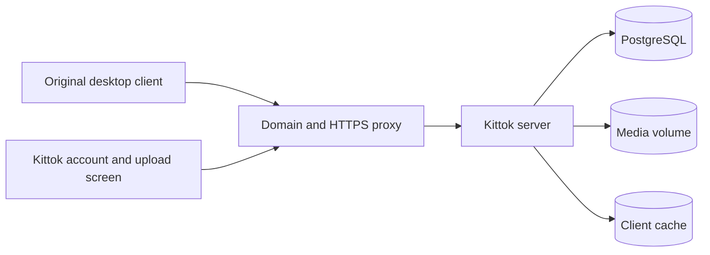

# Architecture

Kittok has an HTTP server, PostgreSQL, local media storage, and a pinned copy of the original desktop web client in `client/`.

`routes/api.mjs` defines Kittok's own stable API under `/api/v1`. `routes/compatibility.mjs` answers the observed TikTok API shapes. `routes/im.mjs` speaks the client's protobuf direct-message protocol over HTTP and the WebSocket in `im/frontier.mjs`. All of them use the same PostgreSQL records and media storage. The compatibility code does not forward API requests to TikTok. A browser bridge routes recognized remote API URLs locally, and Content Security Policy blocks outbound connections and remote frames, forms, scripts, and media. The captured client needs inline script and eval support.

`client/archive.mjs` caches assets from four fixed CDN origins, plus the exact public login-module manifest path. The repo ships the tested capture; `scripts/capture.mjs` makes a new one from the public guest page without account cookies, records its build metadata, and downloads initial entry assets. It also captures the original standalone login application and its entry assets. The native Passport login endpoint decodes the client’s transport encoding, authenticates against Kittok’s PostgreSQL users, and issues the same host-only local session used by the Kittok API. Native success navigation is rewritten to this instance. Additional assets are cached on first request. Guest identifiers and public-origin settings are replaced before the client is served. A local telemetry dependency remains because the client calls its initialization interface; outbound collection is blocked.

## Data

PostgreSQL stores users, password hashes, sessions, invite hashes, video metadata, likes, favorites, follows, blocks, comments, conversations, and messages. SQL migrations have ordered names, SHA-256 checksums, an advisory lock, and transaction boundaries. `pg` returns bigint IDs as strings so JavaScript does not lose precision. Foreign keys and unique constraints enforce relationships and one like per user/video pair.

Passwords use scrypt with a random salt. Session cookies contain random 256-bit tokens; only their hashes are stored in PostgreSQL. Sessions expire after 30 days and have per-session CSRF tokens. Host/origin checks use configured `PUBLIC_ORIGIN`, not untrusted proxy headers. Sign-ups can be closed, invite-only, or open. Every installation creates its own administrators.

Video uploads are bounded, received into a hidden incoming directory, probed, transcoded to H.264/AAC MP4, and given a JPEG cover. Stored media names are random UUIDs. Video metadata is committed after processing succeeds. The server streams media and supports byte ranges. Failed processing removes its output files. A crash can leave orphaned media files; automatic orphan reconciliation and a durable job queue are future work.

## Boundaries

This foundation runs one application process per instance. Rate limits, upload concurrency, and open DM sockets are in memory, so live DM pushes only reach sockets on the same process. PostgreSQL and media persist across restarts. Horizontal scaling, distributed rate limiting, object storage, moderation queues, mail delivery, notifications, and federation need further implementation. `/health/ready` checks PostgreSQL. Administrator-only debug endpoints show unsupported client requests without retaining bodies or credentials.

The source archive uses an allowlist. Instance configuration, captured third-party assets, uploaded media, dependency installations, and database volumes are excluded. Regenerate `/source` after local source changes or point `SOURCE_URL` at your current published source.
